<div align="center">

# C++ Projects

### A broad, learning-focused archive of C++ work: games, math tools, file handling, algorithms, and OOP.

From basic exercises to object-oriented programming, from classic algorithms to small text-based games.


</div>

---

<div align="center">

</div>

## About

This repository collects a wide range of C++ projects written while learning the language, grouped by theme below.

---

## Contents

### Game logic

- Hangman
- Number-guessing game
- Simple text-based mini games
- Interactive decision mechanics
- Tic-tac-toe and a small Minesweeper

### Math and logic

- Calculator, interest and average calculators
- Date, time, counter, and stopwatch programs
- Programs that process user-supplied input

### File handling and data

- Writing to, reading from, and updating files
- A simple student-record system
- A grade-tracking system

### Algorithms and data structures

- Bubble sort, selection sort, insertion sort
- Binary search, linear search
- Array, pointer, and string manipulation

### OOP and core C++

- Classes and objects
- Constructors and encapsulation
- Memory management and pointer usage
- Functions, prototypes, and modular code

---

## Notes

Source files are stored as `.txt` snippets. To run one, copy its contents into a `.cpp` file and compile, for example:

```bash
g++ program.cpp -o program
./program
```
